# RoadFix

Road damage reporting app with map locations, severity analysis, and citizen and staff dashboards.

## Workflow

1. Citizen submits damage report.
2. Backend stores location and media.
3. Optional AI assesses severity.
4. Staff reviews and prioritizes repair.

## Getting started

Configure `backend/.env` from `backend/.env.example`, install backend requirements, and run the FastAPI server. Install frontend packages and start the React app separately.

## License

No new license is granted for contributors’ existing code. Contact the contributors before reuse or relicensing.
